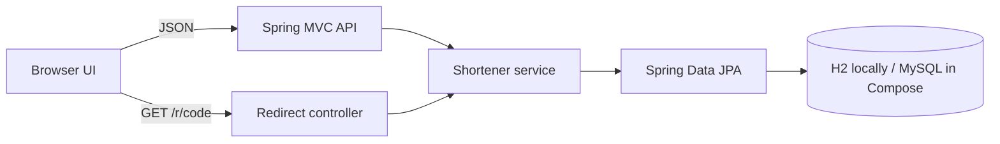

# snip — URL shortener

[](https://github.com/Ias2027/url-shortener-using-springboot/actions/workflows/ci.yml)

A full-stack URL shortener built with Java 17 and Spring Boot 3.5.16. Create links with optional expiry, redirect visitors, and track clicks. It runs locally with a persistent H2 database and supports MySQL for a deployment-style setup.

## Run locally

Requirements: Java 17+ and Maven 3.6.3+.

```bash
cd url-shortener
mvn spring-boot:run
```

Open [http://localhost:8080](http://localhost:8080). The app uses a persistent H2 file in this folder; no database installation or credentials are needed. Set `PORT` to change the local HTTP port.

## Run with MySQL

Requirements: Docker with Compose.

1. From the repository root, copy `.env.example` to `.env` and replace the sample password.
2. Start the app and database:

   ```bash
   docker compose up --build
   ```

3. Open [http://localhost:8080](http://localhost:8080).

The MySQL data stays in the `mysql-data` Docker volume. The database uses a binary collation because Base62 codes distinguish uppercase and lowercase letters.

## Architecture



The browser UI and API are served by the same Spring Boot app. The service validates destinations, creates an ID-backed Base62 code, and stores the mapping through JPA. Redirects update the click counter atomically before returning HTTP 302.

## API

| Method | Endpoint | Description |
| --- | --- | --- |
| `POST` | `/api/urls/shorten` | Create a short link. Accepts `url` and optional `expiresInMinutes`. |
| `GET` | `/api/urls/{code}/stats` | Return click count, creation time, and expiry. |
| `GET` | `/r/{code}` | Increment clicks and redirect to the destination. |
| `GET` | `/actuator/health` | Minimal application and database health status. |

Create a link:

```bash
curl -i -X POST http://localhost:8080/api/urls/shorten \
  -H "Content-Type: application/json" \
  -d '{"url":"https://spring.io","expiresInMinutes":60}'
```

The API returns `201 Created` with `shortCode`, `shortUrl`, `originalUrl`, `clickCount`, `createdAt`, and `expiresAt`. Expiry must be between 1 minute and 1 year. Invalid input returns `400`; missing or expired codes return `404`.

## Configuration

| Variable | Local default | Purpose |
| --- | --- | --- |
| `PORT` | `8080` | HTTP listener port |
| `DB_URL` | `jdbc:h2:file:./url_shortener` | JDBC URL |
| `DB_USERNAME` | `sa` | Database user |
| `DB_PASSWORD` | empty | Database password |

For an external MySQL database, set all three `DB_*` values and use a binary collation for the `short_code` column so codes remain case-sensitive. Keep credentials in environment variables or a deployment secret store. Never commit `.env`.

## Design decisions

- **Base62 of the database ID:** guarantees unique codes without a collision retry. The trade-off is that codes are sequential and guessable.
- **One link per request:** shortening the same destination again creates a separate link, so each requested expiry works as entered.
- **Atomic click updates:** avoids lost increments when multiple visitors open a link at the same time.
- **H2 locally, MySQL in Compose:** keeps the first run simple while making the MySQL deployment path reproducible.
- **Schema updates:** Hibernate creates and updates tables for this demo. A production deployment should use versioned Flyway or Liquibase migrations.

## Build and deployment

GitHub Actions runs `mvn verify` on pushes to `main` and pull requests. To build the executable jar locally:

```bash
cd url-shortener
mvn clean verify
```

The project includes a multi-stage Dockerfile. Configure `PORT`, `DB_URL`, `DB_USERNAME`, and `DB_PASSWORD` in a hosting platform. Use `/actuator/health/readiness` as the readiness check; no environment or configuration endpoints are exposed.

## Scope and next steps

This project demonstrates Spring MVC, validation, JPA, relational persistence, Docker, and CI. It does not include user accounts, per-user link ownership, or rate limiting, so it should not be exposed as a public production shortener without those controls. Useful next additions are authentication, Redis caching, and API integration tests.
